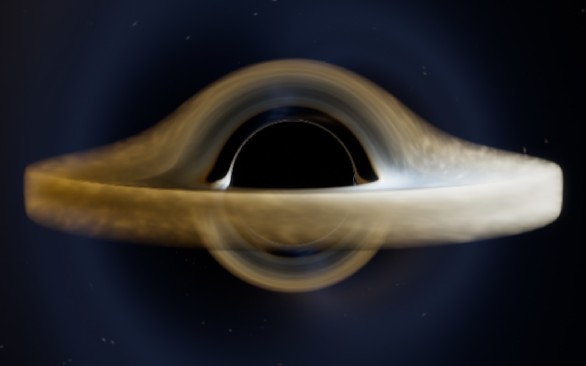
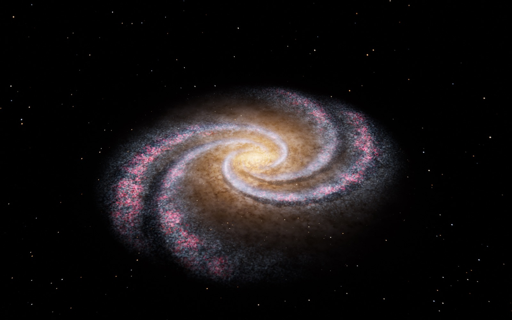

# Milky Way Studio

一个在 Mac 本地运行的程序化银河系渲染器。目标不是做一张“星空插画”，而是用可解释的星系结构模型，在 Metal 上实时预览、并渐进累积出高分辨率静帧。

当前版本（v3）在 v2 的体积渲染、星粒子、高清尘埃和受限 N-body 之上，加入了一个可切换的**黑洞模式**：Schwarzschild 零测地线追踪、相对论薄吸积盘、引力红移、多普勒 beaming、光子环和背景星光透镜。左上角的 `MILKY WAY / BLACK HOLE` 开关用于切换两个场景。





## 1. 技术选择：为什么是 Metal + 体积渲染？

**SwiftUI + Metal 4** 是这台 Mac 上最合适的一组：

- 原生 GPU API，没有 WebGL/WebGPU 的兼容层和驱动开销；
- 可以用 compute shader 一次性生成高分辨率三维星系场，再用 fragment shader 做发射-吸收光线步进；
- 支持 HDR 浮点累积、渐进式超采样和 16-bit PNG 输出；
- 不需要 CUDA，也不需要外接渲染器。

银河系在 10 万光年尺度上，绝大多数恒星是**不可分辨**的。把 1000 亿颗恒星逐颗画出来既不现实，也不是照片里看到的样子。更合适的做法是把恒星、尘埃、HII 区当成**连续介质**：

- 三维体纹理存“单位体积的发光 + 消光”；
- 沿视线积分辐射转移方程；
- 尘埃按波长做红化；
- 年轻星团、HII 区、尘埃云作为多尺度结构叠加在盘面上。

因此本项目的核心是 **640 × 320 × 640 的 RGBA16F 银河体数据**（约 0.06–0.08 kpc/体素），加一盏“可旋转的照相机”，而不是 N-body 粒子系统。N-body 当然可以做，但 10^11 个粒子在单机上不可行，而且对最终照片的贡献主要是整体引力势和旋臂形态，这两者可以用解析模型更高效地表达。

## 1.5 v2 新增：星粒子、高清尘埃与受限 N-body

### 星粒子层

- 120,000 颗独立星粒子，分布在薄盘/厚盘和旋臂上；
- 每颗星有独立的颜色、亮度和屏幕尺寸；
- 用 GPU 点精灵/实例化四边形绘制为亚像素到几像素的高斯 PSF；
- **逐星消光**：在顶点阶段沿“恒星 → 相机”方向对尘埃体做 8 次采样，按 RGB 不同消光系数计算红化；
- 恒星层是独立 pass，叠加在体积渲染之后；关掉它即可回到纯体积模式。

### 高清尘埃

- 基础银河体是 640×320×640 RGBA16F；
- 额外生成 **1024×256×1024 R16F** 的高频尘埃调制场（约为基础体积横向分辨率的 1.6 倍）；
- 在光线步进中用它调制基础尘埃，重点增强旋臂内缘、冷云和纤维结构；
- 为避免实时预览掉帧，移动相机/自转时自动使用基础尘埃；暂停或渲染最终帧时启用高清尘埃。

### 受限 N-body 恒星动力学

- 可选开关“N-body 恒星动力学”；
- 120k 星粒子在**固定引力势 + 螺旋密度波扰动**中做 leapfrog 积分；
- 不是完整自引力 N-body（没有粒子间相互引力），属于 galactic dynamics 里常用的 **restricted N-body / test-particle** 方法；
- 打开后星粒子按 `v(r)` 和密度波势场真实轨道运动，不再只是解析地按 `Ω(r)` 旋转。

### 气体动力学

气体/尘埃的大尺度分布仍由**密度波体积场**表示；真正的 SPH 气体求解器还没有接入。这是当前版本明确的下一步：把气体粒子、压力、冷却和恒星形成接到一起，才能称为完整的 SPH/N-body 星系模拟。

## 1.6 v3：黑洞模式

左上角 `BLACK HOLE` 进入。黑洞场景与银河系共用同一个 Metal 视图、渐进累积、泛光、ACES 和 16-bit PNG 导出，但使用独立的全屏测地线追踪管线。

### 物理模型

- **时空**：Schwarzschild 度规，`R_s = 1`、`c = 1`、`M = 1/2`；相机在有限半径处；
- **光线**：在光子轨道平面内积分 `u'' = -u + 1.5 u²`，RK4，检测事件视界、盘面穿越和逃逸；
- **阴影/光子环**：临界碰撞参数约 `2.598 R_s`；多重盘面像和背景星光透镜由测地线自然产生；
- **吸积盘**：几何薄盘，内缘 `3 R_s`（Schwarzschild ISCO），外缘可调；
- **温度**：`T(r) ∝ (r_in/r)^{3/4} [1 - sqrt(r_in/r)]^{1/4}` 的 Novikov-Thorne 型轮廓，黑体色；
- **相对论效应**：局域开普勒速度的 Doppler 因子、`sqrt(1-R_s/r)` 引力红移、`g⁴` beaming；可开关用于对比；
- **背景**：程序化星场按逃逸方向采样，强透镜下形成爱因斯坦环；
- **喷流**：可选的近似光学薄锥形喷流，沿测地线积分。

### 操作

- 预设：`Gargantua`（近侧视）、`斜视`、`俯视`、`近景`；
- 倾角、距离（`R_s`）、视场、盘温、亮度、外半径、曝光、泛光；
- `相对论多普勒`、`喷流`、`吸积盘旋转` 开关；
- 最终帧：4K/5K/8K，96/128/256 spp，768 步测地线。

### 视觉参考与差异

你之前的网页版是 [DavidLXu/LX_blackhole_sim](https://github.com/DavidLXu/LX_blackhole_sim)（Event Horizon Nocturne）。它采用 WebGL 屏幕空间近似：体积吸积盘、按最近接近距离软化的阴影、程序化星系带、低分辨率 + bloom + grain，所以整体非常柔和。

本 App 没有直接复制它的近似透镜，而是保留 Schwarzschild 测地线，同时借鉴了它的**视觉处理**：

- 吸积盘从“薄面”改为**有垂直高斯厚度的体积流**，并叠加低密度日冕/外辉光；
- 光线步进加入**分层随机采样**，消除固定步长造成的同心环；
- 阴影边缘加入 `closestApproach` 软化；
- 黑洞模式增加 **`柔焦`（0–6 px）** 后处理 PSF，专门压掉光子环和盘缘的锐利感；
- 背景加入柔和的程序化星系带/星云。

这样既保留测地线透镜和相对论频移，又不会像纯物理薄盘那样边缘像刀切。

### 边界

当前是 **Schwarzschild（非旋转）**，没有 Kerr 自旋、frame dragging、GRMHD 湍流、辐射转移或自洽喷流。盘温/亮度是可视参数，不是从质量吸积率解出来的。它追求的是“物理上尽量正确、视觉上接近”，不是数值相对论代码。

## 2. 旋转的物理：不是整盘等角速度

先约定方向：**从北银极俯视，银河系顺时针旋转**；从南银极看则是逆时针。本项目的“俯视”相机位于 +Y（北侧），因此画面中的旋臂、尘埃和星粒子都沿顺时针方向运动。

旋臂采用**尾随（trailing）**缠绕：固定相位为

```text
phi + ln(r) / tan(pitch) = const
```

这样外端的旋臂在旋转方向上落后于内端，符合真实旋臂“拖在后面”的形态。之前版本用了相反的 `phi - ln(r)/tan(pitch)`，会得到前导（leading）旋臂，看起来方向就“反了”。

这是这一版最重要的修正。

### 2.1 旋转曲线

旋转曲线不再用任意拟合，而是由同一个**质量模型**生成：

- 核球：Hernquist，`M_b = 1×10^10 M☉`，`a = 0.8 kpc`
- 盘（恒星 + 气体）：Miyamoto-Nagai，`M_d = 7×10^10 M☉`，`a = 4 kpc`，`b = 0.3 kpc`
- 暗物质晕：NFW，`M_200 = 1.2×10^12 M☉`，`r_s = 25 kpc`，`c = 8`

```text
v_c(r) = sqrt( v_bulge² + v_disk² + v_halo² )
Ω(r)   = v_c(r) / r
```

这样得到约 220 km/s 的平坦外区、自然上升的内区，而不是人为的 `tanh`。体积渲染、星粒子初始条件和受限 N-body 积分器使用**同一条曲线**。界面里的曲线图也直接读取这个质量模型，并标出与旋臂图案速度的共转半径。

### 2.2 旋臂为什么不会一直缠绕？

如果所有恒星和气体都按 `Ω(r)` 转，旋臂会随时间越缠越紧，这就是经典的 **winding problem**。真实的旋臂通常被解释为**密度波**：旋臂是引力势中的图案，以近似恒定的图案速度 `Ωp` 旋转；恒星和星际介质则按 `Ω(r)` 穿过旋臂。

本项目采用这种双层模型：

- 大尺度旋臂、棒、HII 区：以 `Ωp = 24 km/s/kpc` 的图案速度旋转，保持旋臂形态；
- 细尺度尘埃、分子云和星团纹理：按 `Ω(r)` 做**较差自转**，相对旋臂产生剪切和流动；
- 因此你会看到尘埃带穿过旋臂、被拉长、形成更致密的纤维状结构，而旋臂本身不会被完全缠绕掉。

界面里的 **“物理较差自转”** 开关控制这层剪切；**“复位”** 把演化时间归零。

> 这不是完整的 N-body + 流体模拟，而是“密度波 + 解析旋转曲线 + 程序化星际介质”的可视化模型。它的目标是物理上自洽、视觉上接近，而不是做星系形成数值实验。

## 3. 视觉模型

- **盘**：指数盘 + 薄盘/厚盘，带轻微翘曲和径向增厚；
- **核球与棒**：Sérsic 型核球 + 扁长棒，棒内带尘埃带；
- **旋臂**：两组对数螺旋（主臂 + 次臂），可调螺距，带羽状分支和噪声扰动；
- **尘埃**：盘尘埃 + 旋臂内缘尘埃带 + 冷分子云 + 纤维状尘埃，按 RGB 不同消光系数红化；
- **恒星形成**：蓝色年轻星团、粉红色 HII 区、致密星云结；
- **背景**：程序化星场，按温度着色；
- **后期**：多级泛光、ACES 色调映射、轻微色散、暗角、胶片颗粒。

## 4. 性能与输出

在这台 Apple M5 Pro 上：

- 实时预览：约 1.08 MP 内部渲染，2 spp/帧，64 步，星粒子开启，约 **59–60 FPS**；高清尘埃在移动时自动关闭；
- 最终静帧：3840 × 2400，96 spp，384 步，星粒子 + 高清尘埃，约 **50 秒**（CLI 实测）；
- 输出：**16-bit PNG**，色彩空间 sRGB，保留 HDR 色调映射后的精度；
- 支持 4K / 5K / 8K 长边，以及 64 / 128 / 256 spp。

预览在相机静止时会继续累积（最多 64 spp），停得越久越干净；开始自转或拖动相机后重新采样。

## 5. 运行

要求：macOS 14+，Apple Silicon 推荐。

```bash
cd MilkyWayStudio
./build.sh
open "build/Milky Way Studio.app"
```

也可以直接双击 `build/Milky Way Studio.app`。首次启动会编译 Metal 着色器并生成体数据，约 1–3 秒。

### 操作

- 拖拽画面：环绕；
- 滚轮 / 触控板捏合：缩放；
- 双击：重置相机；
- 空格：暂停 / 继续自转；
- Tab：显示 / 隐藏侧栏；
- ⌘R：渲染最终帧；
- ⌘B：侧栏；
- 左上角 `MILKY WAY / BLACK HOLE`：切换星系与黑洞；
- 侧栏可调：倾角、距离、视场、尘埃、曝光、泛光、自转速度、物理较差自转、星粒子层、高清尘埃、N-body 恒星动力学、预览质量、4K/5K/8K、采样数；
- 黑洞模式另有盘温、亮度、外半径、多普勒、喷流和吸积盘旋转。

### 最终帧

点击 **“渲染最终帧”**，选择保存位置。渲染按当前视角比例输出，长边由侧栏的“长边”决定。渲染过程中可以取消；完成后可直接在 Finder 中显示。

## 5.5 离线模拟器与视频

离线模拟器单独放在另一个仓库：

- [milky-way-offline-sim](https://github.com/DavidLXu/milky-way-offline-sim)
- [PHYSICS.md](https://github.com/DavidLXu/milky-way-offline-sim/blob/main/PHYSICS.md)
- [离线视频](https://github.com/DavidLXu/milky-way-offline-sim/blob/main/video/MilkyWay_Offline_1080p.mp4)

那边包含 120k 星粒子 + 30k SPH 气体粒子、512² 粒子-网格自引力、压力/冷却/恒星形成，以及完整的方程、参数、数值格式和“未建模项”清单。2.5D 原型在 50–100 Myr 会出现棒不稳定，因此没有直接拿它当银河系成片。

本仓库的高保真视频使用主渲染器的物理改进模型离线渲染（质量模型旋转曲线、trailing 旋臂、星粒子、逐星消光、高清尘埃），不是 SPH 快照的逐帧渲染。

## 6. 命令行

```bash
./build/galaxycli \
  --out render.png \
  --width 3840 --height 2400 \
  --samples 96 --steps 384 \
  --az 34 --el 36 --dist 54 \
  --exposure 0.22 --bloom 0.30 --dust 0.85 --time 80
```

用于批量出图或对比参数。黑洞模式：

```bash
./build/galaxycli --blackhole \
  --out blackhole.png \
  --width 3840 --height 2400 --samples 96 --steps 768 \
  --az 34 --el 6 --dist 30 --fov 30 \
  --exposure -2.0 --bloom 0.28 \
  --bh-temp 5500 --bh-brightness 0.8 --bh-outer 10
```

## 7. 文件结构

```text
Sources/
  App.swift             App 入口 / 菜单
  ContentView.swift     SwiftUI 界面、旋转曲线图
  MetalViewport.swift   MTKView 与相机交互
  GalaxyRenderer.swift  预览累积、最终帧、PNG 导出
  GalaxyEngine.swift    Metal 管线、体数据生成、光线步进
  AstroModel.swift      核球 + 盘 + NFW 晕的质量模型
  ShaderTypes.swift     与 Metal 对应的 uniform / 相机
  StudioState.swift     界面状态（银河系 / 黑洞）
  Shaders.metal         星系生成 + 体积渲染 + 黑洞测地线 + 泛光 + 合成
  CLI/main.swift        离线 CLI
Resources/
  Info.plist
  AppIcon.icns
build.sh
```

## 8. 已知边界 / 仍不符合物理的地方

- **没有活的自引力**：恒星在由质量模型给出的静态势场中运动；N-body 是 restricted/test-particle，不是粒子间相互引力。质量模型本身是自洽的，但不是自引力演化。
- **没有 SPH 气体**：气体/尘埃的大尺度分布仍由密度波体积场表示，没有气体粒子的压力、冷却、粘性、恒星形成和反馈闭环。
- **恒星种群是近似**：星粒子的颜色/亮度按简单族群混合生成，没有完整 IMF、年龄-金属丰度关系和恒星演化。
- **尘埃不是由气体/金属丰度产生的**：尘埃场是程序化的，只通过 `R_V ≈ 3.1` 的近似消光比例做红化；没有尘埃温度、远红外再辐射、散射。
- **没有反馈**：没有超新星、星风、辐射压、宇宙线、磁场；这些会改变气体盘结构和恒星形成。
- **尺度是代表性的**：120k 星粒子 + 体积场代表约 10^11 颗恒星，不是逐星模拟。
- **暗物质是静态 NFW 晕**：没有宇宙学吸积、并合、暗物质自洽演化。
- **辐射转移是发射-吸收积分**：没有散射、荧光、非局部辐射场。
- **黑洞是 Schwarzschild（非旋转）**：没有 Kerr 自旋、frame dragging、ISCO 随自旋变化。
- **黑洞盘不是 GRMHD**：盘温、亮度、外半径是可视参数；没有磁压、湍流发电机、辐射转移或自洽喷流。
- **黑洞喷流是近似**：光学薄锥形喷流沿测地线积分，没有相对论喷流动力学和准直机制。

这些不是调参能全部解决的；要真正补上 SPH + 自引力，需要一个独立的离线模拟器（粒子-网格/树引力 + SPH + cooling + star formation/feedback），再把快照交给当前渲染器。


- 不是全 N-body / 磁流体模拟；星粒子是受限 N-body（固定势场），气体仍是密度波体积场，**SPH 尚未接入**。
- 高清尘埃是 1024×256×1024 的调制场，不是完全独立的 1024³ 气体密度/发射体；它主要增强高频尘埃结构。
- 体积分辨率约 0.05–0.08 kpc，无法解析单个 HII 区或分子云；细节来自多尺度噪声与细节纹理。
- 程序化尘埃/星云在极高分辨率下仍会有“绘画感”，与真实巡天照片的复杂多相介质有差距。
- 当前为 Apple Silicon 构建；Intel Mac 需要把 `build.sh` 里的 target 改成 universal 并重新编译。
